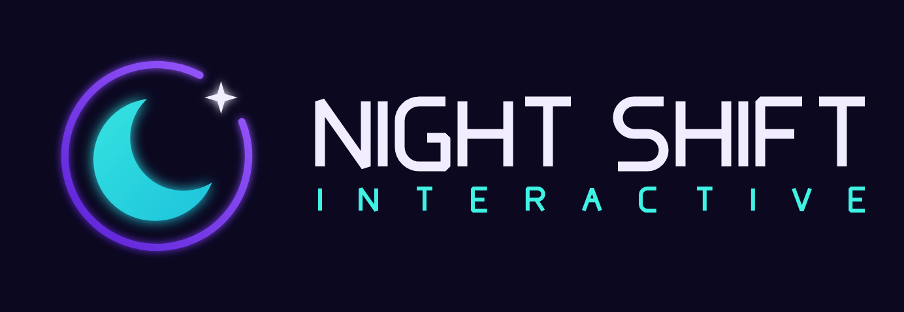
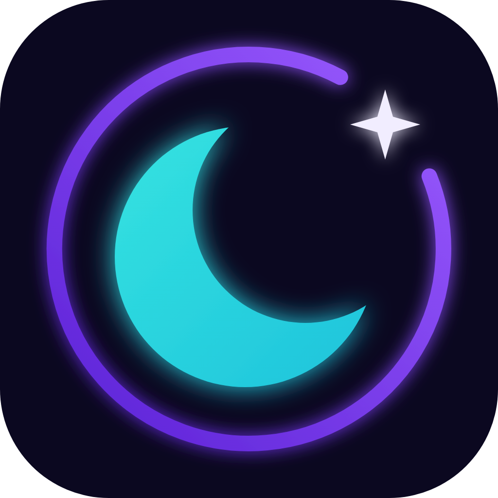
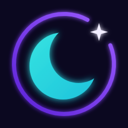

# Night Shift Interactive: Studio Logo

  

## Variations
| File | Use |
|---|---|
| `svg/nsi-lockup-dark.svg` / `-transparent.svg` | Full horizontal lockup: badge + wordmark |
| `svg/nsi-badge-dark.svg` / `-transparent.svg` | Standalone badge, for splash screens, favicons, watermarks |
| `svg/nsi-badge-app-icon.svg` | Badge on a rounded dark tile, for store or app icons |

PNG renders are in `png/`, with badge sizes from 1024 down to 64px.

## Design
- **Mark:** an aqua crescent moon inside an open purple ring (the "shift badge"). A star sits in the ring's gap.
- **Wordmark:** custom monoline geometric glyphs with chamfered joins. They are drawn as SVG paths, so no font is needed.
- **Palette**

  | Role | Hex |
  |---|---|
  | Background | `#0B0820` |
  | Ink | `#F1EDFF` |
  | Purple | `#5B21D6` → `#9B5CFF` |
  | Aqua | `#3FF2E3` → `#14B4D9` |

## Editing
Change colors, spacing or geometry in `build.py`, then run `python3 build.py` to regenerate `svg/`.
